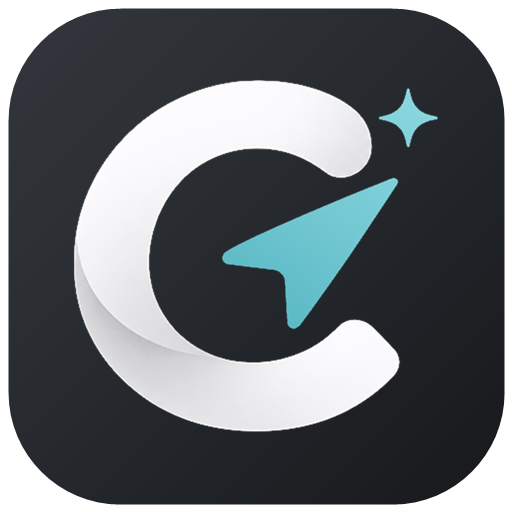
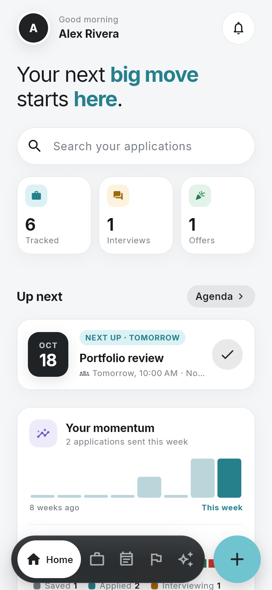
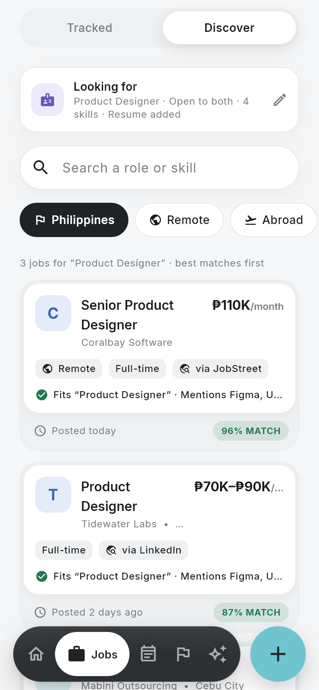
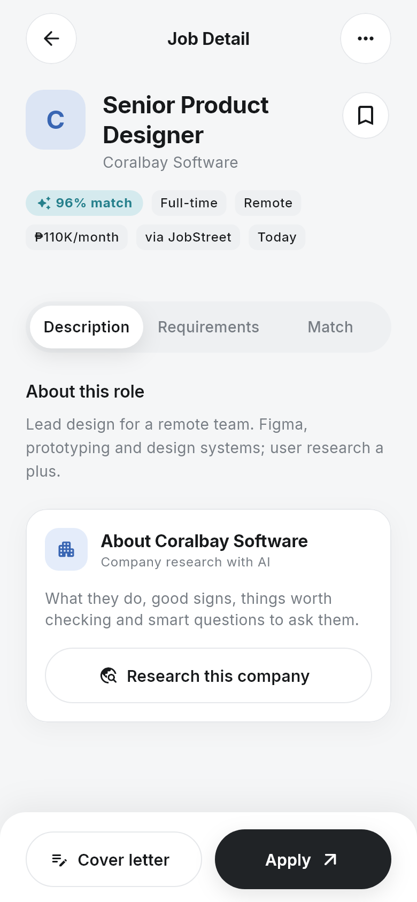
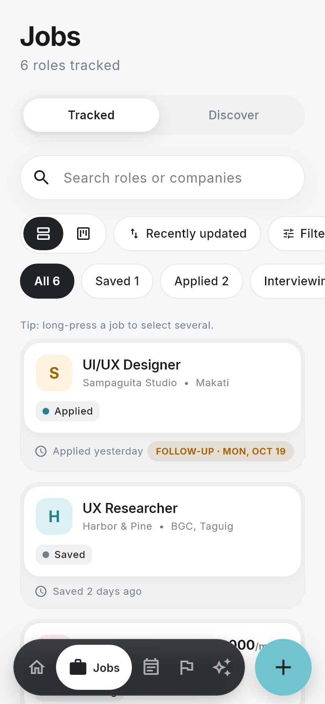
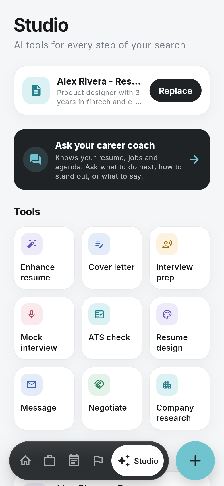
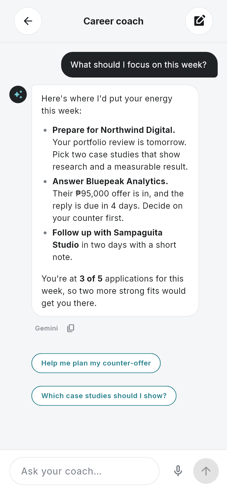
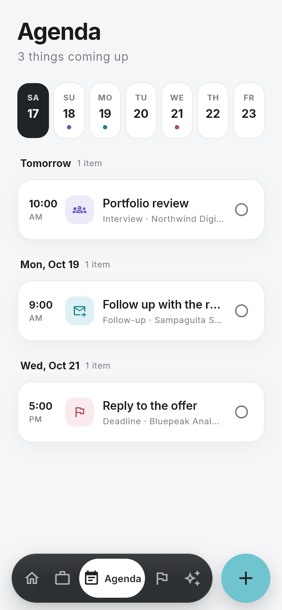
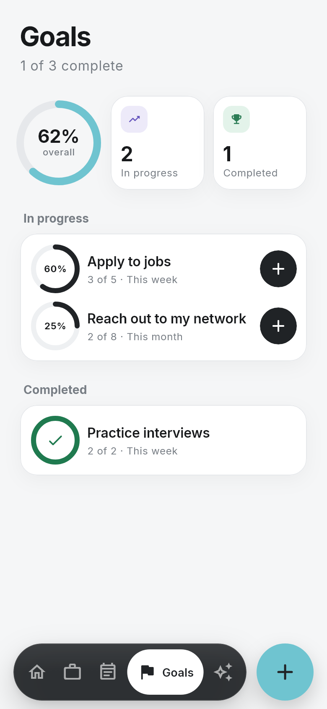
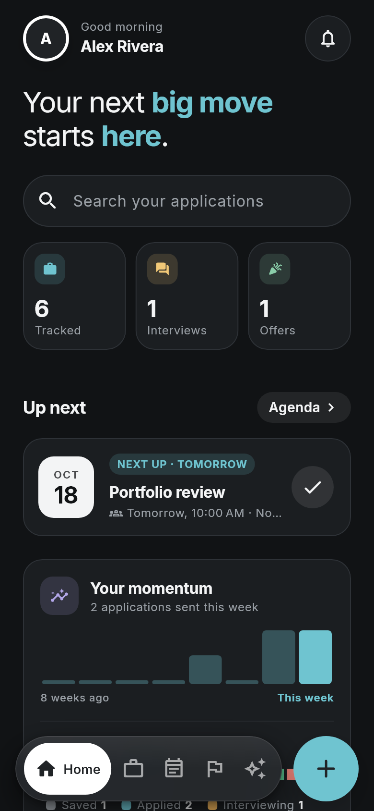

<div align="center">



# Careerly

**A personal career workspace for the Philippine job market.**
Find jobs that fit, track every application, prepare with AI, and apply faster, all in one Android app.


</div>

<br />

<table>
  <tr>
    <td align="center"><br /><sub><b>Home</b></sub></td>
    <td align="center"><br /><sub><b>Discover</b></sub></td>
    <td align="center"><br /><sub><b>Job detail</b></sub></td>
    <td align="center"><br /><sub><b>Tracker</b></sub></td>
  </tr>
  <tr>
    <td align="center"><br /><sub><b>Studio</b></sub></td>
    <td align="center"><br /><sub><b>Career coach</b></sub></td>
    <td align="center"><br /><sub><b>Agenda</b></sub></td>
    <td align="center"><br /><sub><b>Goals</b></sub></td>
  </tr>
</table>

<p align="center">
  <br />
  <sub><b>Dark mode</b></sub>
</p>

<sub>The screenshots use demo data. They're rendered from the real UI, and you can regenerate them with one command (see <a href="#screenshots">Screenshots</a>).</sub>

## Features

### Find jobs
- **Discover:** search JSearch (LinkedIn, Indeed, JobStreet and more) and Jooble. AI web search is the backup. Results can be in the Philippines, remote, or abroad.
- **Match scoring:** each result is ranked against your career profile and resume, with a short explanation of why it fits, plus warnings for posts that look like scams.
- **Job alerts:** a daily background check runs your saved searches and sends a notification when new matches appear.
- **Bring jobs in:** share a job post from any app, or paste a link. OnlineJobs.ph links are read without AI. Careerly only opens the page you share and never scrapes.

### Track everything
- **Application tracker:** switch between a list and a kanban board, with search, sorting, filters, bulk actions, and drag-and-drop between stages.
- **Timeline:** each application keeps its status history, plus notes and agenda items linked to it.
- **Agenda:** interviews, follow-ups and deadlines appear on a week strip, with reminders on your phone.
- **Goals:** weekly and monthly targets, with progress rings.
- **Home:** what's next, weekly momentum and your pipeline at a glance.

### AI Studio
| Tool | What it does |
| --- | --- |
| **Career coach** | Chat with a coach that knows your profile, resume, tracked jobs, agenda and goals, with suggested follow-up questions and voice input |
| **Enhance resume** | Rewrites your resume with stronger, keyword-rich bullets, and never invents experience |
| **Cover letter** | Writes a letter for a specific job, in the tone and length you pick |
| **Interview prep** | Builds a kit of likely questions with suggested answers for the role |
| **Mock interview** | Practice answering out loud, with feedback on each answer |
| **ATS check** | Scores your resume against a job post: keywords, sections, measurable results, length |
| **Resume design** | Exports your resume as a PDF in one of four layouts |
| **Message** | Drafts follow-up, thank-you and offer emails |
| **Negotiate** | Builds a salary plan with a counter-offer, talking points, a ready-to-send email and a call script |
| **Company research** | Gives a company brief: what they do, good signs, red flags, and questions to ask them |

### Apply faster
- **In-app apply browser:** open an application page inside Careerly and tap **Fill with Careerly**. It fills the form from your details, your saved answers, then AI drafts, and you review every field before anything is submitted.
- **Saved answers:** answers you've given before are reused on similar questions in later applications.
- **Apply by email:** when a post asks you to email your application, Careerly opens a ready email with your resume PDF attached.
- **"Did you apply?":** when you come back from an application page, Careerly asks once and records the application, with a follow-up date.

### Polish
- Light and dark themes, built on a shared design system with Inter type.
- Dynamic Island-style notices with undo.
- Biometric app lock.
- A notification center.
- A first-run Get started flow.

## AI providers

Every AI feature goes through one chain that falls back automatically:

```
Gemini (gemini-flash-latest)  →  Groq (openai/gpt-oss-120b)  →  OpenAI (gpt-5.4-mini)
```

OpenAI is used only when both Gemini and Groq fail or time out. Chat replies give each provider 30 seconds before moving on; documents get 90 seconds. Groq can't read PDF files, so PDFs that have no extracted text skip it.

## Tech stack

| Area | Choice |
| --- | --- |
| App | Flutter 3.47, Dart 3.13, Material 3 |
| Backend | Supabase: Auth, Postgres with row-level security, Storage for profile photos |
| AI | Gemini, Groq and OpenAI over HTTP, with automatic fallback (`lib/core/ai`) |
| Job data | JSearch (OpenWeb Ninja), Jooble |
| Documents | `pdf` and `printing` to build PDFs, `pdfrx` to read and preview them |
| On-device | `shared_preferences`, `local_auth`, `flutter_local_notifications`, `workmanager` (daily job alerts), `speech_to_text` |
| Integrations | `webview_flutter` (apply browser), `receive_sharing_intent`, `share_plus`, `url_launcher`, `file_picker`, `image_picker` |
| Quality | `flutter_lints`, plus unit and widget tests across features |

## Setup

1. Copy `.env.app.example` to `.env.app` and fill in:
   - The Supabase URL and anon/publishable key.
   - The JSearch (OpenWeb Ninja) and Jooble keys, for job search.
   - The Gemini, Groq and OpenAI keys, for the AI features (tried in that order).

   Everything in `.env.app` is bundled into the app. That's fine for this personal, sideloaded build, but never put the service role key there.
2. `.env.local` (template: `.env.example`) holds every secret, including the ones the app must not ship with, such as the service role key.
3. Create the database tables: open the Supabase dashboard, go to **SQL Editor**, and run each file in `supabase/migrations/` in filename order. Every file except the first is safe to re-run.
4. Create your account from the app's sign-up screen, or in the Supabase dashboard under **Authentication → Users**. Afterwards you can turn off public sign-ups under **Authentication → Sign In / Providers**.

## Run

```sh
flutter run --dart-define-from-file=.env.app
```

In VS Code, the **Careerly** launch configuration passes this flag for you.

## Test

```sh
flutter analyze
flutter test
```

## Release APK

```sh
flutter build apk --release --dart-define-from-file=.env.app
```

The APK lands in `build/app/outputs/flutter-apk/app-release.apk`. It's signed with `android/careerly-release.jks`, using the passwords in `android/key.properties`. Both files are git-ignored, so back them up somewhere safe: updates must be signed with the same key to install over the existing app and keep its data. Bump `version` in `pubspec.yaml` for each release.

After changing the logo, regenerate the icon and launch screen with `dart run flutter_launcher_icons` and `dart run flutter_native_splash:create`. Settings for both are in `pubspec.yaml`.

## Screenshots

The images in `docs/screenshots` come from `test/screenshots/readme_screenshots_test.dart`. It renders the real screens with demo data and the bundled fonts. The test is skipped in normal runs. To regenerate the images after a UI change:

```sh
flutter test test/screenshots --update-goldens --dart-define=README_SCREENSHOTS=true
```

## Project structure

```
lib/
  main.dart            App entry: config + Supabase init
  app.dart             MaterialApp, themes, root route
  core/
    ai/                AI providers with automatic fallback
    config/            Build-time environment values
    theme/             Colors, accents, spacing, ThemeData
    utils/             Date and error helpers
    voice/             Dictation on the device's speech recognizer
    widgets/           Shared UI: cards, headers, chips, island notices
  features/
    auth/              Login, sign-up, biometric unlock
    shell/             Tabs, floating nav bar, shared workspace data
    dashboard/         Home tab
    applications/      Job application tracker and board
    agenda/            Interviews and reminders
    goals/             Career goals
    discover/          Job search (JSearch, Jooble, AI) and match scoring
    job_alerts/        Daily background check of saved searches
    job_import/        Shared and pasted job posts (incl. OnlineJobs.ph)
    profile/           Career profile used for matching
    onboarding/        First-run Get started flow
    resume/            Resume upload and AI reading
    studio/            Studio tab, resume enhancement, cover letters
    career_coach/      AI career coach chat
    interview_prep/    AI interview kits and mock interviews
    ats/               ATS resume check
    company_research/  AI company briefs
    negotiation/       Salary negotiation coach
    messages/          Follow-up, thank-you and offer emails
    apply/             Apply browser, form filling, saved answers, email apply
    documents/         Saved resumes and cover letters, PDF designs
    notifications/     Device notifications and the notification center
    reminders/         Agenda reminders
    settings/          Profile screen and photo
    (each has data/ for models + repositories, presentation/ for UI)
assets/
  branding/            Icon and launch-screen layers cut from the logo
  fonts/               Bundled fonts (Inter, OFL licensed)
  icons/               App logo
docs/screenshots/      README screenshots (generated)
supabase/migrations/   Database schema (SQL, run in order)
test/                  Mirrors lib/ structure
```
